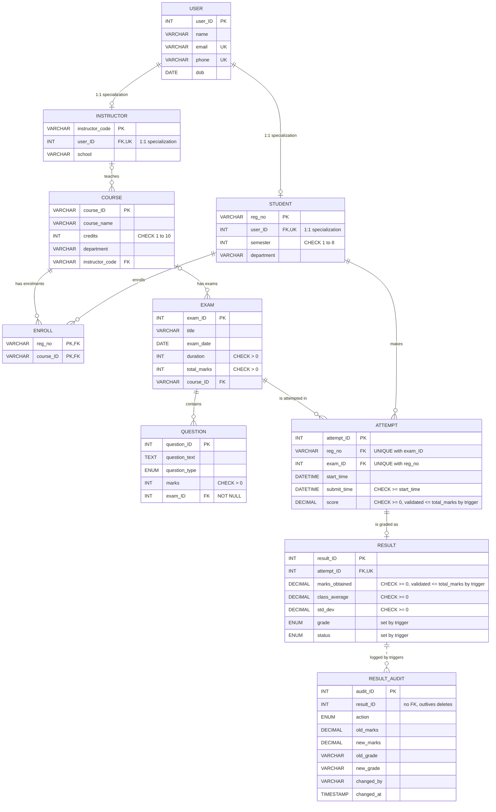

# ER Diagram — ExamVault (Online Exam Management System)

---

## Normalization Analysis (1NF, 2NF, 3NF & BCNF)

### First Normal Form (1NF)
- **Criterion:** Every column contains only atomic (indivisible) values, and each record is unique.
- **In ExamVault:**
  - No repeating groups or comma-separated lists (e.g. `phone`, `credits`, and multiple enrollments are not packed into a single string).
  - Every table possesses an explicit primary key.

### Second Normal Form (2NF)
- **Criterion:** The table is in 1NF and contains no **partial functional dependencies** (no non-prime attribute depends on a proper subset of a composite candidate key).
- **In ExamVault:**
  - The only table with a composite candidate key is `ENROLL(reg_no, course_ID)`.
  - `ENROLL` contains no non-prime attributes; its candidate key is $(reg\_no, course\_ID)$ and the entire tuple consists of prime attributes. Hence, no partial functional dependency is possible.
  - All other tables have single-column primary keys, which automatically satisfies 2NF.

### Third Normal Form (3NF)
- **Criterion:** The table is in 2NF and contains no **transitive functional dependencies** ($X \to Y$ where $Y$ is a non-prime attribute and $X$ is not a superkey).
- **In ExamVault:**
  - In `STUDENT`, all non-prime attributes (`semester`, `department`) depend directly on `reg_no`.
  - In `COURSE`, `course_name`, `credits`, and `department` depend directly on `course_ID`.
  - Derived attributes like calculated grades are not permanently stored as independent unlinked facts: `grade` and `status` in `RESULT` are strictly governed and synchronized by `BEFORE INSERT/UPDATE` database triggers tied to the primary key.

### Boyce-Codd Normal Form (BCNF) Analysis
- **Criterion:** A relation is in BCNF if and only if for every non-trivial functional dependency $X \to Y$, determinant $X$ is a **superkey**.
- **Case 1: `USER`**
  - Primary & Alternate Keys: $\{user\_ID\}$, $\{email\}$, $\{phone\}$.
  - Functional Dependencies: $user\_ID \to name, email, phone, dob$; $email \to user\_ID, name, phone, dob$; $phone \to user\_ID, name, email, dob$.
  - Because every determinant is a superkey (enforced by PRIMARY KEY and UNIQUE constraints), `USER` satisfies BCNF under these stated dependencies.
- **Case 2: `STUDENT`**
  - Candidate Keys: $\{reg\_no\}$ (PK), $\{user\_ID\}$ (enforced by UNIQUE `uq_student_user`).
  - Functional Dependencies: $reg\_no \to user\_ID, semester, department$; $user\_ID \to reg\_no, semester, department$.
  - Each determinant is a candidate key. Hence, `STUDENT` satisfies BCNF.
- **Case 3: `INSTRUCTOR`**
  - Candidate Keys: $\{instructor\_code\}$ (PK), $\{user\_ID\}$ (enforced by UNIQUE `uq_instructor_user`).
  - Functional Dependencies: $instructor\_code \to user\_ID, school$; $user\_ID \to instructor\_code, school$.
  - Each determinant is a candidate key. Hence, `INSTRUCTOR` satisfies BCNF.
- **Case 4: `ENROLL`**
  - Candidate Key: $\{ (reg\_no, course\_ID) \}$.
  - Contains only the composite key; no non-trivial dependencies where determinant is not a superkey. Satisfies BCNF.
- **Case 5: `COURSE`, `EXAM`, `QUESTION`, `ATTEMPT`, `RESULT`**
  - In each table, the designated primary key ($course\_ID$, $exam\_ID$, $question\_ID$, $attempt\_ID$, $result\_ID$) functionally determines all other attributes.
  - In `ATTEMPT`, $(reg\_no, exam\_ID)$ is also a candidate key via UNIQUE `uq_attempt_student_exam`, and it determines $attempt\_ID, start\_time, submit\_time, score$.
  - In `RESULT`, $attempt\_ID$ is also a candidate key via UNIQUE.
  - Across all documented functional dependencies, determinants are candidate keys. Thus, the schema is normalized to 3NF / BCNF to the extent justified by these documented dependencies and constraints.
